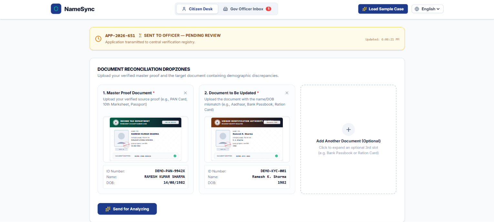
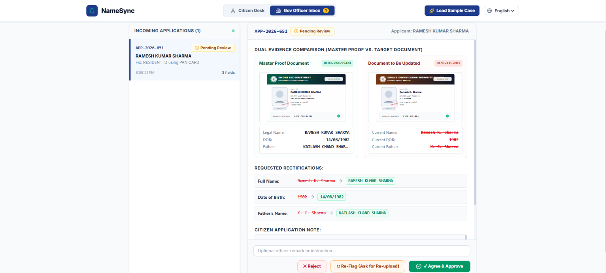

# NameSync — Two-Sided Civic Demographic Reconciliation Platform

**Track 1: Civic Pulse, Digital Governance & Public Information**  
*Built for IDEA FORGE 2026*

NameSync bridges the gap between everyday citizens and government verification offices by turning confusing document name and date-of-birth mismatches into a fast, transparent, two-way digital workflow.

---

## The Problem

Across India, millions of citizens—including elderly pensioners, students applying for scholarships, Direct Benefit Transfer (DBT) beneficiaries, and first-time bank applicants—routinely lose access to vital funds over tiny differences across their identity records. A middle name written as an initial on one card, a minor spelling variation in a father's name, or a single-digit birth-year difference across PAN cards, resident identity cards, and bank passbooks can bring verification to a complete halt.

When citizens apply to fix these errors, verifying officers rarely provide clear feedback explaining why an application was rejected or which document needs to be updated first. Instead, applications are closed with vague statuses like *"Document Mismatch"* or *"Rejected"*, leaving citizens—many navigating regional language barriers—stuck in endless office-to-office loops while clerks spend hours manually comparing blurry scans.

---

## Key Features

### 1. Citizen Desk (Pre-Verification & Multilingual Dispatch)
* **Simple 2-Slot + Optional Upload:** Upload a **Master Proof Document** (e.g., Resident ID, 10th Marksheet, or PAN) and the **Document to Be Updated**, with an optional third slot for fixing multiple records together.
* **Multimodal Regional-Language Extraction:** Reads document photos across regional Indian scripts (including Kannada and English) and extracts standardized identity fields automatically.
* **Plain-Language Visual Diffs:** Replaces dense legal jargon with color-coded red-to-green comparison rows (`Old Value` → `New Value`) and clear guidance on which document to update first.
* **5-Language Support:** Full UI and auto-drafted rectification application generation in **English (`EN`)**, **Hindi (`HI`)**, **Kannada (`KN`)**, **Tamil (`TA`)**, and **Telugu (`TE`)**.
* **Live Status Tracking:** Dispatches the complete verification packet directly to the officer queue and displays real-time status updates (`Pending Review`, `Approved & Synced`, `Re-Flagged`, or `Rejected`).

### 2. Government Officer Verification Inbox (1-Second Visual Triage)
* **Live Incoming Queue:** Displays citizen-dispatched correction packets in real time without manual re-entry.
* **Dual Evidence Comparison:** Shows both the **Master Proof Photo** and the **Target Document Photo** side by side alongside highlighted field diffs and the citizen's formal request letter.
* **1-Click Officer Decisions:** Officers can **Agree & Approve**, **Re-Flag (Ask for Re-upload)** with clear instructions, or **Reject** with structured feedback—syncing the decision back to the Citizen Desk immediately.

---

## Screenshots

### Citizen Desk — Upload, Mismatch Diff & Live Status

### Government Officer Inbox — Dual Evidence Comparison & 1-Click Approval

---

## How It Works (End-to-End Flow)

1. **Upload Documents:** The citizen uploads their Master Proof in Slot 1 and the mismatched document in Slot 2 (or clicks **Load Sample Case** for an instant demo).
2. **Analyze & Review:** AI Vision extracts key identity fields, highlights exact name/DOB discrepancies, and drafts a formal correction application in the user's chosen language.
3. **Dispatch to Officer:** Clicking **Send to Officer Portal** creates a tracked verification packet and places it into the live officer queue.
4. **Officer Review & Sync:** The verifying officer inspects both document images side by side and clicks **Agree & Approve** (or provides clear feedback), immediately updating the citizen's status banner.

---

## Tech Stack

* **Frontend:** React, TypeScript, Tailwind CSS
* **AI & Vision Extraction:** Google Gemini Multimodal Vision API
* **Architecture:** Two-sided state-synchronized web application (Citizen Desk + Government Officer Receiving Desk)

---
